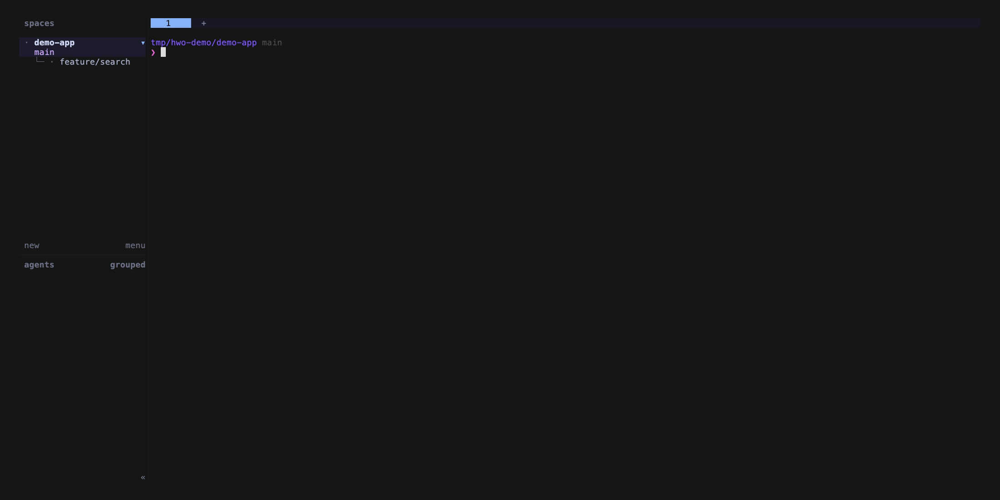

# herdr-worktree-origin

A Herdr plugin that opens any branch in its own worktree from a keybinding.
Pick a local or fetched remote branch in a popup, and Herdr focuses its
worktree workspace. If the branch has no worktree yet, the plugin creates one.

## Demo



## How a pick works

```text
press the keybinding, then pick a local or fetched remote branch
├── has a worktree          focus that worktree
├── local, no worktree      create a worktree and focus it
└── remote only             create a local branch that tracks the remote,
                            then create a worktree and focus it
```

A remote branch such as `origin/feature/billing` becomes a local
`feature/billing`. If a local branch with that name already exists, the plugin
stops and asks you to pick the local branch instead. If tracking setup fails,
the plugin removes the new worktree and branch.

The picker never fetches. Run `git fetch --all --prune` first to see new remote
branches.

The picker works from the repo's main workspace and from any of its worktree
workspaces.

## Picker keys

| Key | Effect |
| --- | --- |
| Typing | Filter the branch list |
| `Enter` | Open or create the worktree for the highlighted branch |
| `esc` | Cancel |

## Requirements

- Herdr 0.8.0+
- Bash, Git, [`jq`](https://jqlang.github.io/jq/), [`fzf`](https://github.com/junegunn/fzf)

## Install

```bash
herdr plugin install astwys/herdr-worktree-origin
```

Or while developing:

```bash
herdr plugin link /path/to/herdr-worktree-origin
```

### Keybindings

Herdr doesn't bind keys for plugins. You own the keys in
`~/.config/herdr/config.toml`:

```toml
[[keys.command]]
key = "prefix+alt+w"        # my binding; any free chord works
type = "plugin_action"
command = "herdr-worktree-origin.new-worktree-origin"
description = "open branch worktree"
```

Then run `herdr server reload-config`.

## Recording the demo

```bash
./demo/setup.sh
vhs demo/demo.tape
./demo/teardown.sh
```

`setup.sh` starts an isolated Herdr session and a throwaway repo in
`/tmp/hwo-demo`, so the recording touches no real workspace.
